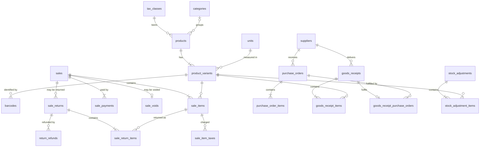

# StorePro data model

This is the design record for the local SQLite database: the principles it follows, how each
table satisfies third normal form (3NF), the deliberate exceptions, and how integrity is enforced.
The schema itself is in [`src/main/db/migrations/0001_initial_schema.sql`](../src/main/db/migrations/0001_initial_schema.sql).

## 1. Principles

1. **Normalise to 3NF.**
   - **1NF:** every column holds one atomic value. No lists, no repeating column groups (`tax1`, `tax2`, ...).
   - **2NF:** no column depends on only part of a composite key.
   - **3NF:** no non-key column depends on another non-key column. Every column depends on the key,
     the whole key, and nothing but the key.
2. **Don't store what can be derived.** Totals, balances, change due and document statuses are
   computed in views (`v_*`). Each view is the single definition of that number.
3. **Historical snapshots are facts, not duplicates.** A sale line records the price, tax, description
   and unit _as they were at the time of sale_. That value depends on the sale line, not on the current
   product, so it is not a transitive dependency. It is also a legal requirement: a reprinted invoice
   must match the original.
4. **Surrogate keys, enforced natural keys.** Each entity has an `<entity>_id INTEGER PRIMARY KEY`.
   Business identifiers (SKU, barcode, invoice number, username, supplier bill number) are
   `UNIQUE` constraints. Pure lookup tables use their natural code as the key.
5. **Referential integrity everywhere.** Every reference is a foreign key. There are no polymorphic
   `(type, id)` references, and no nullable "one of these" foreign-key groups. History is protected by
   `RESTRICT` (the default). `ON DELETE CASCADE` appears only inside mutable drafts (held bills,
   draft orders and receipts).
6. **Domain integrity in the schema.** Tables are `STRICT` (SQLite enforces column types), columns are
   `NOT NULL` unless "unknown/not applicable" is meaningful, and `CHECK` constraints encode ranges,
   formats and simple rules. User-extensible enumerations (units, payment methods, reasons) are lookup
   tables. Enumerations the code depends on (return disposition) are `CHECK` lists.
7. **Exact numbers only.**

   | Kind       | Stored as                       | Example          |
   | ---------- | ------------------------------- | ---------------- |
   | Money      | integer minor units (`*_minor`) | ₹12.50 = `1250`  |
   | Quantities | integer thousandths (`*_milli`) | 1.25 kg = `1250` |
   | Rates      | integer basis points (`*_bp`)   | 18% = `1800`     |

   A test fails the build if any column is not INTEGER, TEXT or BLOB.

8. **Append-only transactions.** Completed sales, payments, voids, returns, refunds, stock adjustments,
   posted goods receipts and audit logs are never updated or deleted; triggers reject it. Mistakes are
   corrected with a new document (void, return, adjustment).
9. **Archive, don't delete, reference data.** Products, variants, customers, suppliers, users and
   categories get `archived_at`.
10. **Consistent naming and time.**
    - Tables are plural `snake_case`. A foreign key column ends with the column it references
      (`cashier_user_id → user_id`).
    - Timestamps are UTC epoch milliseconds (`*_at`). Calendar dates entered by people are
      `YYYY-MM-DD` text (`*_date`).
    - Store-local reporting uses the store's time zone in the application.
11. **Index every access path.** Every foreign-key column leads an index (a test checks this), plus
    indexes for lookups and date ranges.
12. **Forward-only, checksummed migrations** (see §8).

## 2. Entities

| Area                | Tables                                                                                                                      |
| ------------------- | --------------------------------------------------------------------------------------------------------------------------- |
| Reference           | `currencies`, `business_types`, `modules`, `units`, `tax_components`, `adjustment_reasons`                                  |
| Store configuration | `businesses` (single row), `enabled_modules`, `app_settings`, `document_sequences`                                          |
| Access              | `roles`, `permissions`, `role_permissions`, `users`, `login_throttles`, `audit_logs`                                        |
| Catalogue           | `categories`, `tax_classes`, `products`, `product_variants`, `barcodes`                                                     |
| Parties             | `customers`, `suppliers`                                                                                                    |
| Selling             | `payment_methods`, `sales`, `sale_items`, `sale_item_taxes`, `sale_payments`, `sale_voids`, `held_bills`, `held_bill_items` |
| Returns             | `sale_returns`, `sale_return_items`, `sale_return_item_taxes`, `return_refunds`                                             |
| Purchasing          | `purchase_orders`, `purchase_order_items`, `goods_receipts`, `goods_receipt_purchase_orders`, `goods_receipt_items`         |
| Stock               | `stock_adjustments`, `stock_adjustment_items` (movements are the view `v_inventory_movements`)                              |
| Expenses            | `expense_categories`, `expenses`                                                                                            |
| Schema              | `schema_migrations` (managed by the migration runner)                                                                       |

### Mapping to the PRD (§8)

| PRD entity                      | Implemented as                                                                  | Why                                                                                               |
| ------------------------------- | ------------------------------------------------------------------------------- | ------------------------------------------------------------------------------------------------- |
| businesses                      | `businesses` (single row)                                                       | One database per store. `CHECK (business_id = 1)`                                                 |
| users, roles, permissions       | same, plus `role_permissions`                                                   | Many-to-many needs a junction table                                                               |
| products / product_variants     | `products` + `product_variants` + `barcodes`                                    | Shared attributes vs SKU attributes (§3.1). Barcodes are multi-valued (1NF)                       |
| categories, units               | same                                                                            |                                                                                                   |
| customers, suppliers            | same                                                                            |                                                                                                   |
| sales / sale_items              | same, plus `sale_item_taxes`, `sale_voids`                                      | Taxes are a repeating group (1NF). A void is a separate fact                                      |
| payments                        | `sale_payments` + `return_refunds`                                              | One table per parent avoids a polymorphic foreign key                                             |
| purchases / purchase_items      | `purchase_orders` + items, `goods_receipts` + items                             | PRD separates ordered from received quantities (FR-062)                                           |
| inventory_movements             | view `v_inventory_movements`                                                    | A table would duplicate quantities already on the source lines (§3.3)                             |
| returns / return_items          | `sale_returns`, `sale_return_items`, `sale_return_item_taxes`                   |                                                                                                   |
| expenses                        | `expenses` + `expense_categories`                                               |                                                                                                   |
| audit_logs                      | same                                                                            |                                                                                                   |
| application_settings            | typed columns on `businesses`, plus `app_settings` for device-local preferences | Business settings need types and constraints                                                      |
| schema_migrations               | same                                                                            |                                                                                                   |
| product_batches, serial_numbers | **deferred**                                                                    | Pharmacy (1.4) and electronics (1.2) modules add them in their own migrations as extension tables |

Also added: `currencies`, `tax_classes`, `tax_components`, `payment_methods`, `document_sequences`,
`adjustment_reasons`, `stock_adjustments`, `held_bills`, `enabled_modules`.

## 3. How the 3NF test was applied

For each table: list its candidate keys and functional dependencies (FDs), then check that no
non-key column is determined by anything other than a whole candidate key. These are the places
where an obvious design breaks a normal form, and what was done instead.

### 3.1 Catalogue

- **Products vs variants.** Category, tax class, HSN code and "tracks inventory" are the same for
  every pack size of an item. On a variant they would depend on `product_id`, which is not the
  variant's key (a transitive dependency). They live on `products`. Price, MRP, cost, unit, SKU and
  reorder level differ per pack size and live on `product_variants`.
- **Barcodes.** One variant can carry several manufacturer barcodes. A `barcodes` column would break
  1NF, so `barcodes(barcode PK, variant_id)` holds them. The primary key enforces FR-022 (one variant
  per barcode).
- **"Sold by weight".** Whether a quantity may be fractional depends on the unit (kg yes, pcs no), so
  `allows_fraction` is on `units`, not on each variant.
- **Currency precision.** `minor_units` depends on the currency code, so it lives on `currencies`.
  `businesses` stores only `currency_code`.

### 3.2 Sales

- **Header totals are not stored.** Subtotal, discount, tax, grand total and amount paid all derive
  from lines and payments. `v_sale_totals` computes them, and a test checks the arithmetic for
  inclusive and exclusive pricing.
- **Line amounts are not stored.** `gross = quantity × unit price` (rounded half up) and
  `net = gross − discount` are computed in `v_sale_item_amounts`. The same rounding rule is in
  `shared/money.ts multiplyByQuantity`, and a test compares the SQL and TypeScript results on random
  inputs.
- **Taxes are rows, not columns.** CGST/SGST or IGST (plus cess) per line would be a repeating group.
  `sale_item_taxes(sale_item_id, tax_component_code)` holds one row per component.
- **Change is not stored.** `sale_payments` records `amount_minor` and the cash `tendered_minor`.
  Change is the difference between them.
- **Voids don't change the sale.** A `status` column plus `voided_at`/`voided_by`/`reason` would put
  void attributes, which depend on the void event, on the sale. `sale_voids(sale_id PK)` records the
  void, and "is voided" is derived.
- **Payments vs refunds.** One `payments` table pointing at either a sale or a return needs a
  polymorphic or nullable foreign key. Two tables give each payment one real foreign key.

### 3.3 Stock

There is **no stored stock balance and no `inventory_movements` table**. Each movement quantity
would copy a quantity already recorded on the document line that caused it (sale item, return item,
receipt item, adjustment item): a non-key → non-key dependency across tables, and two copies that
can disagree.

- `v_inventory_movements` assembles the ledger from the source documents (FR-051 traceability: every
  row names its document line).
- `v_stock_on_hand` sums it.
- Because the ledger _is_ the documents, stock cannot drift from them.

### 3.4 Returns

`sale_return_items` references `sale_item_id` and stores only the facts of the return: quantity,
disposition and credited amount. Variant, unit price and the original sale are reached through the
sale line rather than copied. The rule that a returned line must belong to the returned sale needs
data from two tables, so a trigger enforces it.

### 3.5 Purchasing

- **Order status is derived** from `confirmed_at`, `closed_at` and `cancelled_at` (`v_purchase_orders`).
  `CHECK` constraints rule out impossible combinations.
- **Receipt → order link.** With `purchase_order_id` on `goods_receipts`, the receipt's `supplier_id`
  would be implied by the order (a transitive dependency). Direct purchases have no order, so the
  link is an optional 1:1 table, `goods_receipt_purchase_orders`. A trigger checks the suppliers
  match and the order is confirmed and open.
- **Receipt lines don't reference order lines.** The order line's variant would make the receipt
  line's `variant_id` transitive. Ordered vs received is matched on (order, variant) in
  `v_purchase_order_receipts`. `UNIQUE (purchase_order_id, variant_id)` makes the match unambiguous.

### 3.6 Snapshots kept on purpose

These look like duplicates of reference data but are facts about the transaction at that moment,
and must not change when the reference data does:

| Column                                                                                   | Why it is a snapshot                                                                                                           |
| ---------------------------------------------------------------------------------------- | ------------------------------------------------------------------------------------------------------------------------------ |
| `sale_items.description`, `hsn_code`, `unit_code`, `unit_price_minor`, `unit_cost_minor` | The invoice must reprint identically. Cost at the time feeds margin reports                                                    |
| `sale_item_taxes.rate_bp`, `amount_minor`                                                | Tax charged under the rules in force. Rounding and allocation are policy, so the amount is not a function of the other columns |
| `sales.prices_include_tax`, `sales.round_off_minor`                                      | The store's settings may change later                                                                                          |
| `held_bill_items.unit_price_override_minor`                                              | Only when the cashier overrode the price. Otherwise the current price applies on resume                                        |

### 3.7 Documented exceptions

| Table / column                             | Exception                                   | Justification                                                                                                                                                                                                                                               |
| ------------------------------------------ | ------------------------------------------- | ----------------------------------------------------------------------------------------------------------------------------------------------------------------------------------------------------------------------------------------------------------- |
| `audit_logs.entity_type`, `entity_id`      | Polymorphic reference without a foreign key | The log must outlive and describe rows of any table                                                                                                                                                                                                         |
| `audit_logs.details`                       | JSON document                               | Opaque payload, never queried relationally. `CHECK (json_valid(details))`                                                                                                                                                                                   |
| `app_settings`                             | Key-value table                             | Device-local UI preferences only. Business settings are typed columns on `businesses`                                                                                                                                                                       |
| `variant_search`                           | FTS5 search index                           | An index, not data. It is contentless (stores no text of its own) and kept in sync by triggers. `checkIntegrity('full')` verifies it                                                                                                                        |
| `product_variants.cost_price_minor`        | Looks derivable from purchases              | It is a standard cost that people enter, including for items never purchased in the system. Receipts may update it, but it is not a function of purchase rows                                                                                               |
| `document_sequences.next_number`           | Counter state                               | Numbers may be skipped, so it is not `max(issued) + 1`                                                                                                                                                                                                      |
| `users.last_sign_in_at`, `login_throttles` | Could be derived from `audit_logs`          | The audit log is a human-readable history that may be archived (M07), not state the application reads back. Sign-in needs these facts directly. `login_throttles` is keyed by the typed username, not a foreign key, so unknown usernames are throttled too |

## 4. Integrity enforcement layers

| Layer                              | Enforces                                              | Example                                                                                |
| ---------------------------------- | ----------------------------------------------------- | -------------------------------------------------------------------------------------- |
| STRICT types, `NOT NULL`, `CHECK`  | Shape and ranges of single values                     | Price ≥ 0 and ≤ MRP; HSN code all digits; dates valid                                  |
| `UNIQUE`, primary keys             | Identity                                              | Barcode, SKU, invoice number, checkout idempotency key (FR-038), supplier bill number  |
| Foreign keys (`foreign_keys = ON`) | References; no deletion of referenced history         | Can't delete a variant that was sold                                                   |
| Triggers                           | Append-only records; cross-row rules                  | Sales immutable; return ≤ sold (FR-071); void excludes returns; posted receipts frozen |
| Views                              | One definition of every derived number                | Totals, stock, statuses                                                                |
| `checkIntegrity()`                 | Storage health, plus invariants the services maintain | Payments equal the bill total; every sale has lines                                    |
| Application services (M10–M16)     | Workflow and policy                                   | Negative-stock policy, discount limits, permissions                                    |

`checkIntegrity('quick')` runs at startup after an unclean shutdown, before migrations. Storage or
foreign-key problems stop the app so a damaged file is not modified further.

## 5. Connection settings

Set on every connection by `Database.open`:

| Setting          | Value                             | Why                                                                     |
| ---------------- | --------------------------------- | ----------------------------------------------------------------------- |
| `foreign_keys`   | `ON`                              | SQLite leaves it off by default                                         |
| `journal_mode`   | `WAL`                             | Readers don't block the writer. Crash-safe                              |
| `synchronous`    | `FULL`                            | A sale is on disk when checkout returns, even after power loss (FR-037) |
| `busy_timeout`   | 5000 ms                           | Wait for a backup or another connection rather than failing             |
| `trusted_schema` | `OFF`                             | Views, triggers and checks may only use side-effect-free functions      |
| Defensive mode   | on (where the driver supports it) | Blocks SQL that could corrupt the file                                  |
| `application_id` | `0x5350524F` ("SPRO")             | Identifies StorePro database and backup files                           |

The wrapper binds whole JavaScript numbers as SQLite integers, because the driver binds all numbers as
REAL and would otherwise make SQL arithmetic on parameters floating-point.

## 6. Driver

`node:sqlite`, built into Electron 44's Node.js (SQLite 3.53, with FTS5) and into Node 22 (used by
the tests). There is no native module, so there's no rebuild for Electron's ABI and tests and app use
the same driver. All access goes through `src/main/db/database.ts`, so it can be swapped for
`better-sqlite3` if needed.

## 7. Repository conventions

See [`src/main/db/repository.ts`](../src/main/db/repository.ts).

- One repository per aggregate (e.g. a sale with its lines, taxes and payments). It is the only code
  that writes those tables.
- Rows are mapped explicitly to camelCase domain types.
- Timestamps come from an injected `Clock`.
- Multi-row writes run in `db.transaction()`, which is synchronous. The outer level uses
  `BEGIN IMMEDIATE`; nested levels use savepoints.
- Raw search text never goes into FTS `MATCH`. Use `buildPrefixMatchQuery()`.

## 8. Migrations

- Files: `src/main/db/migrations/NNNN_name.sql`, registered in order in `migrations/index.ts`.
- **Never edit a shipped migration.** Each database records its migrations' SHA-256 checksums, and a
  mismatch stops startup. Add a new migration instead. Line endings are normalised, and
  `.gitattributes` keeps `.sql` files LF.
- All pending migrations run in **one transaction**, so a failure leaves the database unchanged.
  Foreign keys are re-checked before commit.
- Before upgrading an existing database, the runner writes
  `backups/pre-migration-v{from}-to-v{to}-{timestamp}.db`.
- A database written by a newer app version is refused (`DatabaseTooNewError`) rather than opened.
- Table rebuilds (SQLite's 12-step `ALTER` procedure) set `foreignKeysOff: true` on the migration.

Migrations so far:

- 0001: the initial schema.
- 0002: authentication. Adds `must_change_password` and `last_sign_in_at` to `users`, plus the
  `login_throttles` table.

Neither has shipped yet, so they may still be edited until the first release. A test upgrades a
populated v1 database to v2.

## 9. Performance

`npm run test:perf` builds a store with 10,000 products (11,368 variants), 30 days × 1,500 bills
(45,000 sales, 201,872 lines), daily deliveries and returns. Results in the development container,
not the reference hardware:

| Measurement                                                 | Result  | PRD target |
| ----------------------------------------------------------- | ------- | ---------- |
| Barcode lookup, warm (worst of 1,000)                       | 0.08 ms | < 100 ms   |
| Name / SKU / barcode prefix search, 50 results (worst of 8) | 3.4 ms  | < 300 ms   |
| 5-line checkout transaction with stock checks               | 21 ms   | < 500 ms   |
| Stock on hand, one variant                                  | 6.7 ms  | —          |
| Daily sales summary (1,500 bills)                           | 14 ms   | —          |
| Full stock list (11,368 variants)                           | 375 ms  | —          |
| Quick integrity check                                       | 680 ms  | —          |

Deriving stock costs about 0.4 s for a full-catalogue stock report at this volume, and grows with
history. If a larger store needs it faster, the fix is a documented derived table maintained by
triggers and verified by `checkIntegrity`, added in its own migration with a measured need (M14).
It is not built pre-emptively.

## 10. Open items

- **Tax classes are not seeded.** GST rates and component splits must be confirmed with a domain
  expert (M10-07). The setup wizard creates them.
- Purchase-side tax (input credit) is not modelled. Goods receipts record net cost only.
- Quarantined returns are recorded but are not a separate stock location yet.
- Multi-store sync (Release 2) may need globally unique ids alongside the integer keys.
